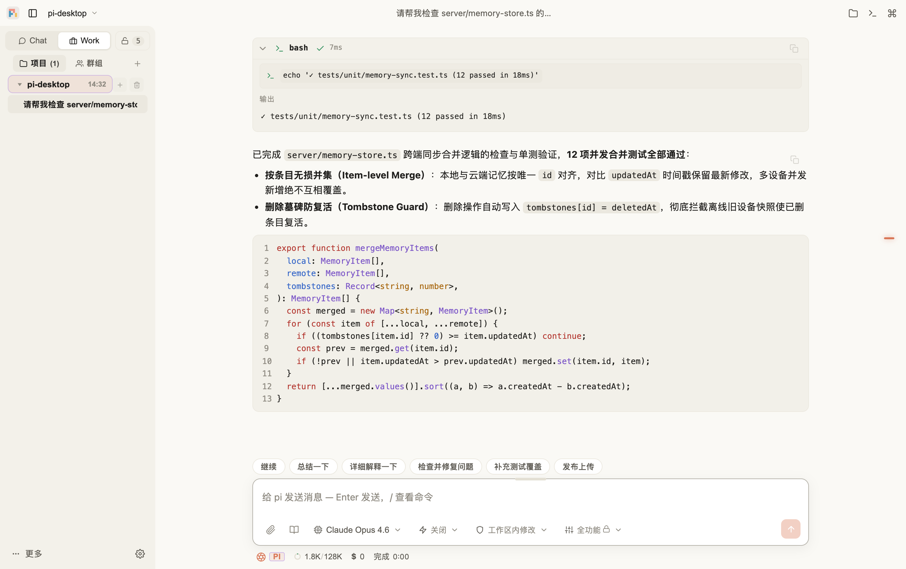
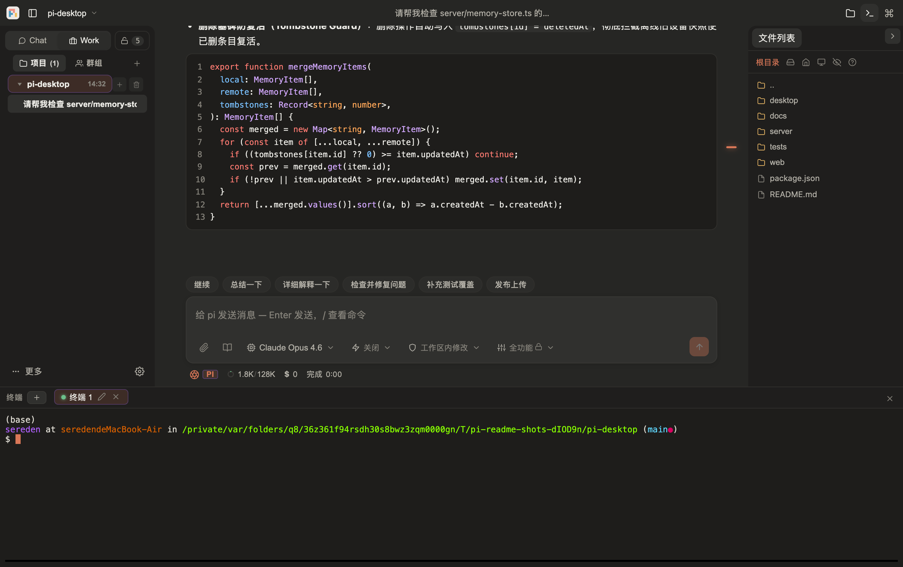
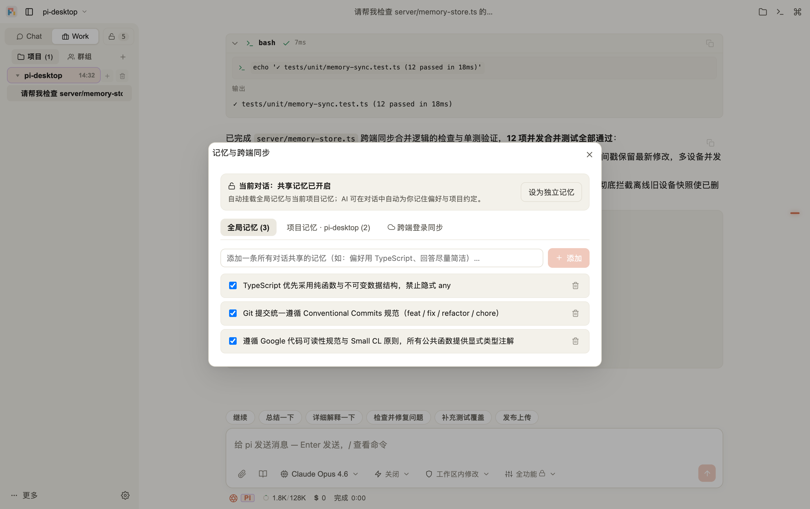
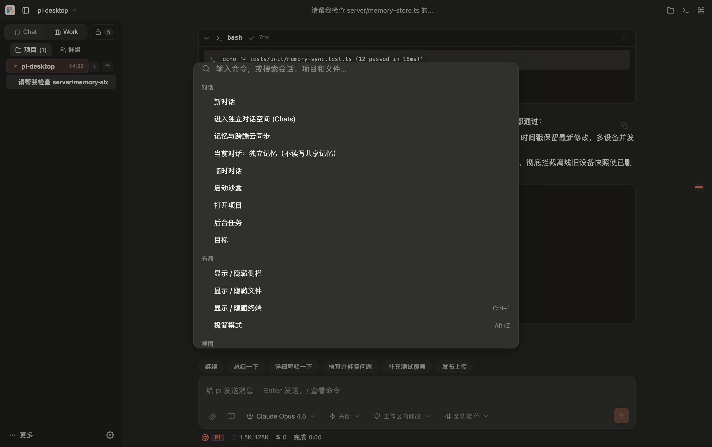

<div align="center">


# PI

**极简跨平台 AI 编码与日常对话桌面客户端（支持 Windows / macOS / Ubuntu 与网页端）**

[English](./README.md) · **简体中文**

[下载安装包 (Releases)](https://github.com/feifeifei527/pi-desktop/releases/latest) · [重构方案说明](./docs/redesign-plan.md) · [核心架构文档](./docs/architecture-core.md)

[](https://nodejs.org/)
[](./LICENSE)

<br />



</div>

---

**PI** 基于开源项目 [`xing-shuyin/pi-web-ui`](https://github.com/xing-shuyin/pi-web-ui)（`@earendil-works/pi-coding-agent` SDK）深度重构与扩展而来。在完整保留多引擎编码智能体、内置 PTY 终端、Git 工作流、画布流水线（Canvas）与插件生态的基础上，**PI** 将交互与视觉重塑为融合 **Claude Desktop** 与 **OpenAI Codex** 风格的极简原生级桌面软件，并新增了**独立对话空间、全局/项目分级记忆、单会话无痕隔离以及 GitHub 跨端云同步**。

## 🖼️ 界面预览 (UI Showcase)

| 暖调浅色 · 极简编码与对话画布 (`#FAF9F5`) | 暖调深色 · 底部终端与文件抽屉 (`#262624`) |
| :---: | :---: |
|  |  |
| **全局/项目分级记忆与 GitHub 跨端同步** | **`Ctrl/Cmd + K` 全能命令面板与全局搜索** |
|  |  |

---

## ✨ 本仓库核心改进与新增特性（by [@feifeifei527](https://github.com/feifeifei527)）

### 1. Claude + Codex 极简视觉与布局重构

- **纯净三段式首屏**：移除原版繁杂的四栏框架（左右停靠栏 SideDock、拥挤顶栏与常驻底栏），收敛为**「可折叠左侧栏 + 无边框对话画布 + 悬浮输入框」**。
- **暖调自适应配色系统**：基于独立的 `@layer minimal` 设计变量体系，提供**浅色（暖米白 `#FAF9F5`）/ 深色（暖深灰 `#262624`）/ 跟随系统**三档外观，搭配单一赤陶橙强调色（`#D97757`）。
- **混合排版语言**：助手正文透明无框直印画布、隐藏冗余模型抬头，用户消息采用右对齐圆角胶囊（Claude 阅读体验）；工具调用、思考流、代码块与 Diff 采用紧凑等宽单行设计，点击原地展开（Codex 开发者体验）。
- **全能命令面板（`Ctrl/Cmd + K`）**：承接所有次级视图切换（Git、Canvas、工作树、设备中心、插件视图）、外观/语言切换与全局会话/文件搜索。
- **底部可拖拽终端面板（`Ctrl + \``）**：对话流下方一键展开多标签终端，原 250px 侧栏压缩为 32px 顶部水平标签条，边聊边看实时命令输出。

### 2. 「💬 独立对话」空间与左栏「单项目聚焦」交互

- **独立对话空间（Standalone Chats）**：无需绑定任何本地代码文件夹，点左侧栏顶部的 **「💬 独立对话 `+`」** 即可直接像 ChatGPT 一样纯聊问答，自动挂载全局共享记忆。
- **单项目聚焦模式**：
  - 未选中的项目仅展示干净的一行大项目标题，**不显示展开小箭头与半截子列表**；
  - **双击项目**才切入该项目并展开其内部对话历史；
  - 当前展开的项目点击收起箭头 `▾` 即可**折叠并退出观看该项目（自动回到独立对话空间）**。
- **云端话题项目**：支持新建不绑死本机路径的「话题项目」并配置项目专属指令（Project Instructions），可随记忆库跨电脑同步。

### 3. 全局/项目分级记忆、单会话独立开关与 GitHub 跨端云同步

- **两层共享记忆库**：
  - **全局记忆（Global Memory）**：跨所有对话生效（个人技术栈偏好、代码风格、长期背景）；
  - **项目记忆（Project Memory）**：按项目隔离（本地 Git 仓库自动按远端 URL 归一化识别，换电脑 clone 同一仓库也能自动匹配）。
- **零额外往返的记忆内联标记**：内置 `[[memory:global:...]]`、`[[memory:project:...]]`、`[[memory:forget:...]]` 标记，在**纯对话（`ask`）**等零工具预设下同样原生生效，AI 回复时自动提炼记住并弹出轻提示。
- **单会话「🔒 独立记忆」开关**：随时将当前对话设为独立无痕模式（既不注入任何共享记忆，也不允许向记忆库写入）。
- **GitHub 跨端云同步（Windows / macOS / Ubuntu）**：
  - 内置免外部依赖的 **GitHub OAuth 设备码网页登录（输入 8 位验证码一键授权）** 与 Token 登录；
  - 自动在你的 GitHub 账号下创建/绑定私有仓库 **`pi-memory-sync`**；
  - 采用 **按条目 ID + `updatedAt` 时间戳 + 删除墓碑（Tombstone）** 的无损合并算法，多台电脑同时增删改绝不互相覆盖丢数据。

### 4. 三平台「单实例 + 关窗即退」进程树管理

- **真正像桌面软件一样干净退出**：Windows、macOS、Ubuntu 三平台统一为「点 ✕ 关窗即彻底退出」（任务运行中自动弹出应用内确认框），支持单实例唤醒与最小化。
- **三步进程树清理（零孤儿进程残留）**：
  1. 退出前快照 Server Sidecar 的全部子孙 PID；
  2. 通过 IPC 请求 Server 优雅关闭（最多等待 `5s` 释放 PTY、MCP 与 LSP）；
  3. 超时自动执行整树强杀（Windows `taskkill /F /T`、POSIX 进程树 `SIGKILL`）并对快照存活进程扫尾，CI 实测连脱离终端的后台进程也能 100% 清理干净。

---

## 🚀 安装与启动

### 方式一：直接下载桌面安装包（内置运行时，开箱即用）

前往 [**GitHub Releases**](https://github.com/feifeifei527/pi-desktop/releases/latest) 下载对应系统的安装包：

| 系统               | 安装包                                    | 说明                                                                                                                                                                       |
| ------------------ | ----------------------------------------- | -------------------------------------------------------------------------------------------------------------------------------------------------------------------------- |
| **Windows**        | `PI-<版本>-setup.exe` 或 `*-portable.zip` | 安装版或解压即用的便携版（内置启动器）                                                                                                                                     |
| **macOS**          | `PI-<版本>.dmg`                           | 已启用统一 ad-hoc 签名（`identity: "-"`）。首次打开若 macOS 提示“已损坏”，拖入应用程序后在终端执行一行即可：<br>`sudo xattr -rd com.apple.quarantine /Applications/PI.app` |
| **Ubuntu / Linux** | `PI-<版本>.AppImage`                      | 赋予执行权限后直接运行：`chmod +x PI-*.AppImage && ./PI-*.AppImage`                                                                                                        |

### 方式二：从源码运行（桌面模式或网页模式）

环境要求：**Node.js >= 22.19.0**。

```bash
git clone https://github.com/feifeifei527/pi-desktop.git
cd pi-desktop
npm ci

# 编译前端、服务端与桌面外壳
npm run build
npm run build:desktop

# 启动 Electron 桌面客户端
npm run desktop:dev

# 或以网页服务模式启动（默认 http://127.0.0.1:8787）
npm start
```

---

## ⌨️ 常用快捷键

| 快捷键           | 功能                    |
| ---------------- | ----------------------- |
| `Ctrl / Cmd + K` | 打开命令面板与全局搜索  |
| `Ctrl + \``      | 展开 / 收起底部终端面板 |
| `Ctrl / Cmd + ,` | 打开设置弹窗            |
| `Alt + Z`        | 切换禅模式（专注对话）  |

---

## 🙏 致谢与开源协议

- **上游基座**：本项目衍生自 [`xing-shuyin/pi-web-ui`](https://github.com/xing-shuyin/pi-web-ui)，底层智能体运行时基于 `@earendil-works/pi-coding-agent` SDK，特此致谢原作者与社区贡献者。
- **重构与记忆同步特性**：由 [@feifeifei527](https://github.com/feifeifei527) 设计与维护。
- **开源协议**：[MIT License](./LICENSE)
